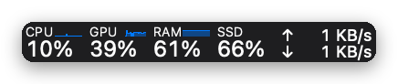
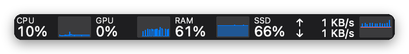
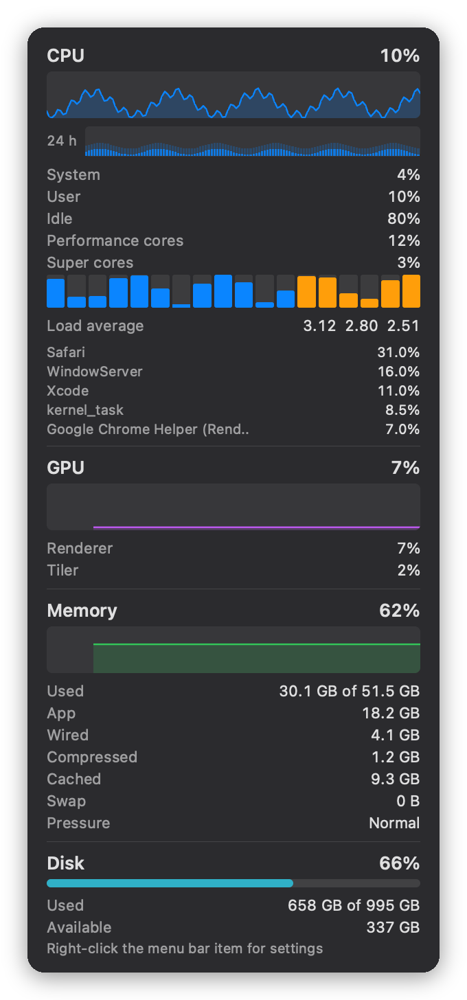

# Stats Lite

A menu bar system monitor for Apple Silicon Macs: CPU, GPU, memory, disk, network, sensors, battery, Bluetooth accessory batteries and a clock. It is a from-scratch rewrite of [Stats](https://github.com/exelban/stats) that aims to cost as little as possible to run.

<p>
  
  <br>
  
</p>



## Use

- **Menu bar.** Each module shows a percentage, a percentage with a small sparkline of the last minute, a history chart, or both. The label turns into a red "CPU!" while the Mac is thermally throttling.
- **Hover.** Current values, recent peaks and when they happened, and the busiest process of the last hour.
- **Click.** A panel with live charts and 24-hour history, per-core load, top processes by CPU and memory, recent CPU spikes and who caused them, memory breakdown, disk space and activity, and sections for the other enabled modules.
- **Right-click.** Settings: modules, display style, refresh rate per module, colored or monochrome charts, labels, notifications and launch at login.

Default refresh rates: CPU, memory and network every second, GPU every 2 s, sensors every 3 s, disk space every minute. The battery updates on power events and the clock on the minute. Notifications are opt-in: CPU above 90% for 30 s, critical memory pressure, disk space under 10%, battery at 20%.

## Install

Requires macOS 13 or later on Apple Silicon and the Xcode Command Line Tools.

```sh
make
cp -R build/StatsLite.app "/Applications/Stats Lite.app"
open "/Applications/Stats Lite.app"
```

`make test` runs the unit tests. `StatsLite --sample 3` prints every metric three times without starting the UI.

## Resource use

Four modules (CPU, GPU, memory, disk) refreshing every second on an M5 Pro; medians of three one-minute runs:

| | CPU | Energy/min | Wakeups/min | Memory |
|---|---|---|---|---|
| Stats 3.0.23 | 2.81% | 440 mJ | 303 | 149 MB |
| Stats Lite | 0.037% | 4.5 mJ | 60 | 13.8 MB |

Most of what remains is the cost of waking once a second, reading the GPU driver's statistics, and handing the window server one new image. [BENCHMARKS.md](BENCHMARKS.md) has the measurements, including what was tried and rejected; the tools are in [bench/](bench/).

## How it works

- C core, AppKit shell, one thread, one timer that fires only as often as the fastest visible module needs. Nothing runs while the display sleeps, the screen is locked, or a full-screen app hides the menu bar.
- Each metric comes from the cheapest kernel interface measured for it. GPU statistics are read with a hand-built IOKit Mach message parsed in place.
- The menu bar and panel are drawn into IOSurfaces handed to Core Animation by reference. Only changed cells and rows are repainted, and charts scroll their existing pixels instead of redrawing. Text is composited from a glyph atlas by a small AArch64 routine.
- Top processes are read only while the panel is open, with idle processes checked less often.

```
src/core/   sampling (sampler, fastio, smc, procs), history, rendering (render, blit, blit_arm64.S, panel)
src/app/    main.m: status item, timer, panel window, settings
tests/      unit tests, including pixel-exact checks of the incremental drawing paths
bench/      measurement tools and results
```

## Limitations

- Apple Silicon only: sensor keys are per chip generation and GPU data comes from the Apple GPU driver.
- Top processes are limited to the current user's processes.
- Bluetooth batteries cover AirPods and Apple keyboards, mice and trackpads; devices that report battery only over Bluetooth LE are not read.
- No remote monitoring and no desktop widgets.
